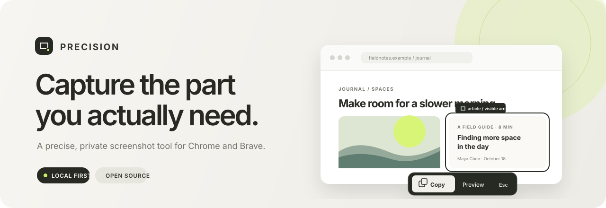
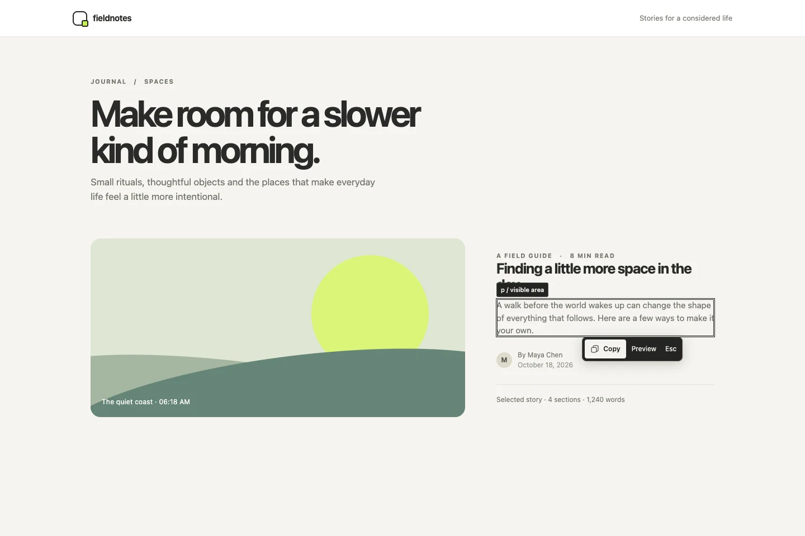
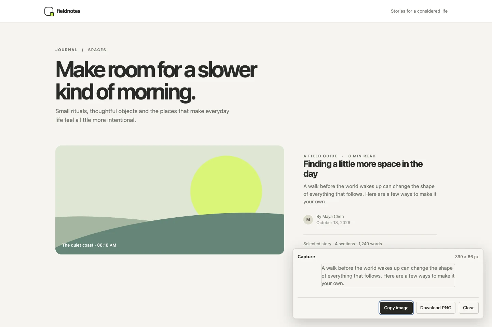

<div align="center">
  

  <p><strong>A local-first screenshot tool for Chrome and Brave.</strong><br />Select an element on the page, then copy it in place or save a PNG.</p>

  <p>
    <a href="https://github.com/20was/precision/actions/workflows/ci.yml"></a>
    <a href="LICENSE"></a>
    <a href="https://github.com/20was/precision/releases"></a>
  </p>
</div>

## See it in action

Real screenshots of the unpacked extension running on the included local showcase page.

<p align="center">
  
  
</p>

## What it does

- Highlights useful DOM elements as you move the pointer.
- Copies a visible element capture directly from the pointer controls, or opens an in-page preview.
- Saves a PNG without opening another tab.
- Uses temporary tab access only after you invoke the extension.
- Keeps screenshots on your device and discards them when you close the preview.

Precision captures the visible pixels inside an element's bounds. Overlapping page content remains in the image; it does not re-render the element in isolation. Full-page capture, editing, annotation, history, and cloud features are outside this release.

## Install from source

Requires Node.js 22 or newer.

```sh
git clone https://github.com/20was/precision.git
cd precision
npm ci
npm run build
```

1. Open `chrome://extensions` in Chrome or `brave://extensions` in Brave.
2. Turn on **Developer mode** and choose **Load unpacked**.
3. Select the repository's `dist` folder.
4. Pin Precision, open a regular webpage, and choose **Start selecting** from its toolbar popup.
5. Hover an element. Choose **Copy** for an in-place copy, or **Preview** / press Enter to review and download.

After rebuilding, reload Precision from the extensions page and refresh the webpage. Browser internal pages, the Chrome Web Store, PDF viewers, and file URLs do not allow the DOM access this feature needs.

## Keyboard controls

| Key          | Action                                          |
| ------------ | ----------------------------------------------- |
| `Escape`     | Cancel selection and restore normal browsing    |
| `Enter`      | Capture the current target and open the preview |
| `Arrow Up`   | Select the nearest visible parent               |
| `Arrow Down` | Select the first visible direct child           |

Selection follows the pointer while the controls stay near it. When the selected element is too small, the controls move beside its bounds. The capture is limited to the visible portion of the element.

## Development

```sh
npm ci
npm run dev
```

`npm run dev` watches TypeScript files. Load `dist` as an unpacked extension, then reload it after changes. Run `npm run check` before submitting changes.

| Command                    | Purpose                                                                                   |
| -------------------------- | ----------------------------------------------------------------------------------------- |
| `npm run build`            | Build the production extension into `dist`                                                |
| `npm run typecheck`        | Run strict TypeScript checks                                                              |
| `npm run lint`             | Run ESLint                                                                                |
| `npm test`                 | Run unit tests                                                                            |
| `npm run test:integration` | Run the actual-extension browser tests where Chrome, Brave, or test Chromium is available |
| `npm run screenshots`      | Rebuild the extension and regenerate the README WebP screenshots with test Chromium       |
| `npm run check`            | Typecheck, lint, unit tests, and production build                                         |

For integration tests, install Playwright Chromium with `npx playwright install chromium`. Chrome and Brave executable paths in the test configuration currently target macOS. The suite skips browser executables that are not installed; inspect [the test report](docs/test-report.md) for verified environments and cases.

The README images are generated from the real unpacked extension on [`showcase.html`](tests/fixtures/showcase.html). They contain no third-party site content.

## Privacy and permissions

Precision requests `activeTab`, `scripting`, and `clipboardWrite`. It does not request broad website access, browsing history, persistent storage, or download permission. It does not upload screenshots, run analytics, or load remote code. See [the architecture notes](docs/architecture.md) for message validation, capture flow, and the coordinate model.

## Project notes

- [Architecture](docs/architecture.md)
- [Milestone 01 plan](docs/milestone-01.md)
- [Test report](docs/test-report.md)
- [Known limitations](docs/known-limitations.md)
- [MIT License](LICENSE)

Precision is in early development. Contributions and issue reports are welcome; please include browser version, operating system, and a reproducible page or test case for capture bugs. No store listing or release has been published.
